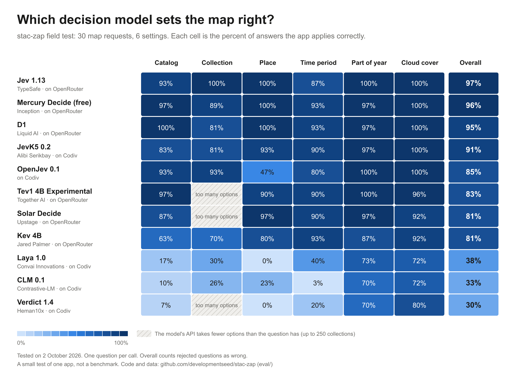

# Decision models for stac-zap

Decision models tested on 2 October 2026. Extraction models tested on
12 November 2026.

stac-zap uses a decision model to turn a short request, for example "Landsat
over Denver in July 2024", into map settings. A decision model does not write
text. It gets a text and a set of questions with fixed options. It returns one
option per question and a probability for each option. stac-zap uses
[Jev 1.13](https://typesafe.ai/blog/introducing-system-one-models-and-jev) by
TypeSafe on OpenRouter.

Many new decision models became available in September 2026. This document
compares 11 of them on the questions that stac-zap asks. It also compares
Jev with extraction models, which read values from the request instead of
selecting options. See [Test 3](#test-3-extraction-models). The scripts and
the raw results are in [eval/](../eval/README.md).

## Summary

- **Jev 1.13 gives the best results for stac-zap.** It is correct on 166 of
  172 questions. It is the only model that selects the correct collection for
  all prompts. This question has the most options, up to 250.
- **Mercury Decide (Inception) and D1 (Liquid AI) are almost as good** on the
  field test: 165 and 164 of 172. They are less accurate on collections and
  on world knowledge.
- **Most open models on Codiv are not yet usable for stac-zap.** JevK5 0.2 is
  the best of them (156 of 172), but it is slow (about 900 ms for each call).
- **Jev 1.13 is also the fastest of the accurate models.** A call takes
  about 300 ms, and the time almost does not increase with the number of
  options. See [Latency](#latency).
- **Some models cannot answer the large questions.** Tev1, Solar Decide and
  Verdict accept at most 20 to 26 options. Respan accepts only yes or no
  questions.
- **The test found a problem in stac-zap.** The app added a cloud cover
  filter that the user did not ask for. A new question text corrects this
  problem. See [Cloud cover](#cloud-cover).
- **An extraction model reads place, time and cloud cover better than the
  option lists.** Clairic (Cloudflare) is correct on 84 of 85 of these
  questions. Jev is correct on 80 of 85. Clairic also reads 13 of 16
  requests that the option lists of the app cannot hold, for example
  "between March 2023 and June 2024" or "under 12% clouds". With three
  rules in code, it reads all 16. Jev reads none of them. See
  [Test 3](#test-3-extraction-models).

## The models

| Model | Maker | Where | Limit |
|---|---|---|---|
| Jev 1.13 (`typesafe/jev-1.13`) | TypeSafe | OpenRouter | |
| Mercury Decide (`inception/mercury-decide:free`) | Inception | OpenRouter | Free version only: 20 requests per minute |
| D1 (`liquid/d1`) | Liquid AI | OpenRouter | |
| Kev 4B (`jaredpalmer/kev-4b`) | Jared Palmer | OpenRouter | |
| Tev1 4B Experimental (`togethercomputer/tev1-4b-experimental`) | Together AI | OpenRouter | 2 to 20 options |
| Solar Decide (`upstage/solar-decide`) | Upstage | OpenRouter | 26 options |
| Span-01 and Span-01 Lite (`respan/...`) | Respan | OpenRouter | Yes or no questions only |
| OpenJev 0.1 (`openjev-latest`) | | Codiv | |
| JevK5 0.2 (`jevk5-0.2`) | Alibi Serikbay | Codiv | |
| CLM 0.1 (`clm-v0.1`) | Contrastive-LM | Codiv | |
| Laya 1.0 (`laya-1.0`) | Convai Innovations | Codiv | |
| Verdict 1.4 (`verdict-1.4`) | Heman10x | Codiv | 24 options |

The Respan models can not answer the questions of stac-zap. They are not in
the results.

## Test 1: the field test

### Procedure

For each request, stac-zap asks these questions:

1. The catalog: one of 13 STAC catalogs.
2. The collection: one of the collections of the catalog, up to 250.
3. The place: the words of the request that name the place, "the map view",
   or "no place".
4. The time period: a year from 2015 to 2026, the last 30 days, the last 12
   months, or all dates.
5. The part of the year: a season, a month, or the whole year.
6. The maximum cloud cover: from 5% to 75%, or no filter.

The test has 30 requests. A person wrote the correct answers for each
request. Some requests have more than one correct answer. The test does not
score a question when no answer is clearly correct.

The test uses the code of the app to make the questions. Thus, each model
gets the same text as in the app. The test then scores each answer as the
app applies it. For example, the app does not change the time period when
the probability of the answer is less than 0.35. The test does the same.

Each question goes in a separate call. Thus, a model that cannot answer a
large question can still answer the small questions. The app asks
questions 2 to 6 in one call.

### Results

Each cell gives the number of correct answers. "Rejected" is the number of
questions that the API of the model did not accept.

| Model | Catalog | Collection | Place | Time period | Part of year | Cloud cover | Total | Median time |
|---|---|---|---|---|---|---|---|---|
| Jev 1.13 | 28/30 | **27/27** | 30/30 | 26/30 | 30/30 | 25/25 | **166/172** | 307 ms |
| Mercury Decide | 29/30 | 24/27 | 30/30 | 28/30 | 29/30 | 25/25 | 165/172 | 424 ms |
| D1 | **30/30** | 22/27 | 30/30 | 28/30 | 29/30 | 25/25 | 164/172 | 309 ms |
| JevK5 0.2 | 25/30 | 22/27 | 28/30 | 27/30 | 29/30 | 25/25 | 156/172 | 884 ms |
| OpenJev 0.1 | 28/30 | 25/27 | 14/30 | 24/30 | 30/30 | 25/25 | 146/172 | 867 ms |
| Tev1 4B | 29/30 | 5/27 (22 rejected) | 27/30 (1 rejected) | 27/30 | 30/30 | 24/25 | 142/172 | 247 ms |
| Solar Decide | 26/30 | 6/27 (21 rejected) | 29/30 (1 rejected) | 27/30 | 29/30 | 23/25 | 140/172 | 1075 ms |
| Kev 4B | 19/30 | 19/27 (1 rejected) | 24/30 | 28/30 | 26/30 | 23/25 | 139/172 | 574 ms |
| Laya 1.0 | 5/30 | 8/27 | 0/30 | 12/30 | 22/30 | 18/25 | 65/172 | 664 ms |
| CLM 0.1 | 3/30 | 7/27 | 7/30 | 1/30 | 21/30 | 18/25 | 57/172 | 679 ms |
| Verdict 1.4 | 2/30 | 2/27 (21 rejected) | 0/30 (1 rejected) | 6/30 | 21/30 | 20/25 | 51/172 | 660 ms |

The cost of one full run (172 calls) is less than $0.02 for each model.

### What the results show

- **The collection question shows the largest differences.** It has the
  most options. Jev 1.13 is correct on all 27 prompts. The next best models
  are correct on 22 to 25.
- **Jev 1.13 selects the wrong catalog for two prompts.** It sends "Sentinel-2
  Level-1C over Rome" and "wildfires in Los Angeles in January 2025" to
  Planetary Computer. The correct catalogs are Earth Search and eoAPI. D1 is
  correct on all 30 prompts.
- **OpenJev 0.1 finds the place in only 14 of 30 prompts,** but it is good on
  the other questions.
- **A model that always selects "keep" gets a high score on some
  questions.** For example, Laya 1.0 and CLM 0.1 get 18 of 25 on cloud cover.
  But they are correct on none of the 7 prompts that ask for a cloud cover.
  The script `eval/summary.ts` shows these two types of prompt separately.

### Cloud cover

The first run of the test found a problem in stac-zap. The app added a cloud
cover filter to requests that do not mention clouds.

For example, for "Landsat over Denver in July 2024", Jev 1.13 did not select
"keep". It gave a probability of about 0.2 to each of several maximum values.
The app uses the median of these values, so it applied a maximum of 15%.

The cause was the question text. The text told the model to select "keep"
only if the request "has nothing to do with" cloud cover. The model reads a
request for optical imagery as a request about clouds.

The new question text is:

> Which maximum cloud cover does the request ask for? Only a request that
> mentions clouds, cloud cover, a clear sky or cloud-free imagery asks for
> one.

The results before and after the change:

| Model | Cloud cover, old text | Cloud cover, new text |
|---|---|---|
| Jev 1.13 | 15/25 | 25/25 |
| Mercury Decide | 22/25 | 25/25 |
| D1 | 20/25 | 25/25 |
| JevK5 0.2 | 11/25 | 25/25 |
| Kev 4B | 10/25 | 23/25 |

The new text did not cause problems with indirect requests. Jev 1.13 still
applies a filter for "clear images of Paris", "sunny day imagery of Madrid"
and "Sentinel-2 of Lima, not too cloudy".

## Test 2: world knowledge

### Procedure

This test finds out if a model knows where a place is. stac-zap does not use
the model for this. It uses a geocoder. But a model that knows the world can
find places that a geocoder does not find, for example "flooding in Porto
Alegre".

The test has 38 places. For each place, the model selects a latitude band
and a longitude band. The test does two types of search:

- **100 bands:** one call with 100 latitude bands and 100 longitude bands.
- **Coarse to fine:** one call with bands of 10°. Then one call with 30
  smaller bands in and around the selected band.

The error is the distance from the true point to the middle of the selected
bands.

### Results

| Model | 100 bands: median error | Coarse to fine: median error | Error less than 100 km | Error less than 250 km |
|---|---|---|---|---|
| Jev 1.13 | 281 km | **110 km** | 18/38 | 22/38 |
| D1 | 552 km | 478 km | 3/38 | 14/38 |
| Mercury Decide | 770 km | 527 km | 2/38 | 7/38 |
| JevK5 0.2 | 4,436 km | 2,917 km | 0/38 | 0/38 |
| Kev 4B | 2,725 km | 3,212 km | 0/38 | 2/38 |
| OpenJev 0.1 | 5,592 km | 3,358 km | 0/38 | 0/38 |
| CLM 0.1 | 6,956 km | 7,054 km | 0/38 | 0/38 |
| Laya 1.0 | 12,089 km | 11,374 km | 0/38 | 0/38 |

Tev1 4B, Solar Decide and Verdict 1.4 did not accept 100 options.

Jev 1.13 knows the world much better than the other models. The open models
on Codiv often select a band on the wrong continent.

## Latency

### Procedure

The field test records the time of each call. The time starts when the
request leaves the computer and stops when the answer arrives. Thus, the
time includes the network. All calls went from one laptop in one run.

### Results

"p90" is the time that 90% of the calls do not exceed.

| Model | Median | p90 | Median, 30 options or fewer | Median, more than 100 options |
|---|---|---|---|---|
| Tev1 4B | 247 ms | 346 ms | 247 ms | Rejected |
| Jev 1.13 | 307 ms | 411 ms | 306 ms | **336 ms** |
| D1 | 309 ms | 457 ms | 306 ms | 461 ms |
| Mercury Decide | 424 ms | 814 ms | 399 ms | 939 ms |
| Kev 4B | 574 ms | 1,032 ms | 552 ms | 1,159 ms |
| Laya 1.0 | 664 ms | 739 ms | 659 ms | 729 ms |
| Verdict 1.4 | 660 ms | 759 ms | 660 ms | Rejected |
| CLM 0.1 | 679 ms | 801 ms | 670 ms | 709 ms |
| OpenJev 0.1 | 867 ms | 1,185 ms | 855 ms | 1,185 ms |
| JevK5 0.2 | 884 ms | 2,501 ms | 845 ms | 2,589 ms |
| Solar Decide | 1,075 ms | **12,871 ms** | 1,075 ms | Rejected |

### What the results show

- **The time of Jev 1.13 almost does not change with the size of the
  question.** A call takes 306 ms with 30 options or fewer, and 336 ms with
  more than 100 options. For D1, the time increases by half. For Mercury
  Decide, the time is more than two times longer. In stac-zap, the
  collection question has the most options, so this difference is
  important.
- **Jev 1.13 and D1 are equally fast on small questions,** at about 300 ms.
- **The models on Codiv take 0.7 to 0.9 s for each call.** On large
  questions, JevK5 0.2 takes about 2.6 s.
- **Solar Decide is not usable for an interactive app.** 10% of its calls
  took more than 12 s. The slowest call took 23 s.
- **Tev1 4B is the fastest model,** but it accepts at most 20 options.

stac-zap makes 2 or 3 calls for each request, one after the other. With
Jev 1.13, these calls take about 1 s in total. With a model on Codiv, they
take 2 to 3 s. The STAC searches and the map data take more time than the
model calls.

### Limits

- The times are from one run, from one computer, at one time of day.
- The Codiv calls had a pause of 1.1 s between them, because of the rate
  limit. Thus, the rate limit did not add time to a call.
- The test asks each question in a separate call. The app asks 5 questions
  in one call. Thus, the time for each request in the app can be different.

## Test 3: extraction models

### What an extraction model is

An extraction model also does not write text. It gets a text and a set of
named fields. Each field has a type, for example text, number or date. The
model returns one value for each field, or null when the text does not
contain the value. It also returns the probability that the value is not
there (`p_null`). Thus, the answer is a value, not an option from a list.

stac-zap asks Jev six questions. Three of them do not select from a set of
things. They read a value from the request:

- **The place.** The app makes every span of 1 to 4 words into an option.
- **The time.** The app has options for each year from 2015, the last 30
  days, the last 12 months, the seasons and the months.
- **The cloud cover.** The app has 10 options, from 5% to 75%, and no
  filter.

When the request asks for a value that is not an option, Jev can only
select the nearest option. Thus, these three questions can use an extraction
model. The catalog and the collection stay with Jev.

### The models

OpenRouter supplies extraction models through its extractions API
(`/api/alpha/extractions`). The documentation of OpenRouter lists six
models. Only two of them answered:

| Model | Maker | Field types | Result |
|---|---|---|---|
| Clairic (`cloudflare/clairic`) | Cloudflare | All, including date | Tested |
| ScaleDown Extract (`scaledown/extract`) | ScaleDown | Text only | Tested on place only |
| Mercury Decide (`inception/mercury-decide`) | Inception | Text only | "No extractions endpoints found" |
| Sage 2 (`levanto/sage-2`) | Levanto | All | "Model does not exist" |
| pplx-decider v1.3 and v1.3 Flash | Perplexity | Text only | "Model does not exist" |

### Procedure

The test uses three sets of requests:

1. **The field test.** The same 30 requests as Test 1, with the same
   correct answers. The test makes the expected place, time range and
   cloud cover from these answers.
2. **The unparsed requests.** 16 new requests that the app cannot parse
   today. For each request, the correct value is not in the option lists.
   Each request tests one field.
3. **The dev requests.** 36 other requests. We used only these requests to
   write the instructions of the fields. Thus, the test requests stayed
   unseen until the last run.

The test scores values, not options:

- **Place:** the words must be the same, if you ignore case, punctuation
  and "the". "Here" or "this area" is the map view. Null is "no place".
- **Time:** the first and the last day must be the same. For a period back
  from today, the last day must be within 1 day, and the first day within
  a fifth of the period.
- **Cloud cover:** the number must be in the range of the correct options,
  for example 15% to 25% for "few clouds". Null is "no filter".

To compare, the test also applies the answers of Jev to the unparsed
requests, as the app does. It makes a range from the period and the part of
the year, and a number from the cloud cover option.

### How to ask Clairic

The text that the model reads changes the results much. We tested five
variants of the state and the instructions on the dev requests:

| Variant | State | Instructions | Dev requests |
|---|---|---|---|
| plain | The request | What each value is | 23/36 |
| hinted | The state of Jev: the app, today's date and the request | Plus the months of each season, and the cloud cover of words such as "clear sky" | 29/36 |
| terse | Today's date and the request | Short phrases, seasons and some periods in code | 31/36 |
| compact-today | Today's date and the request | Full sentences, seasons and some periods in code | 32/36 |
| **compact** | **The state of Jev** | **Full sentences, seasons and some periods in code** | **36/36** |

The compact variant asks for these fields:

- `place` (text): the words that name the place.
- `when` (text): the words that name a time, for example "in 2021" or
  "last summer". If `when` is null, the request does not ask for a time.
- `start` and `end` (date): the first and the last day of the period.
- `cloud` (number): the maximum cloud cover in percent. The instructions
  give the cloud cover of the words of the app, for example "clear sky 10".

Code then makes the range for some time words, with the rules of the app:

- A season, for example "winter 2024" or "last summer". The app function
  `toRange` gives the range, as for an answer of Jev.
- A quarter, for example "Q3 2021".
- A period back from today, for example "the last 3 months".
- "Recent" or "latest": the last 30 days, as the period option of the app.

For other time words, the range comes from `start` and `end`.

We found these problems with the other variants:

- **Today's date in the state makes the model give a range for each
  request.** For example, "orthophotos of Bern" got the last month. The
  `when` field stops this problem.
- **A season text in the instructions changes other months.** For example,
  "June 2024" became June to August. Thus, code does the seasons.
- **Clairic does not do calendar arithmetic well.** It put "winter 2024" in
  December 2024, not December 2023. Cloudflare also says: "have Clairic
  predict the value and let code do the math."
- **Short phrases give worse dates than full sentences.** A short rule for
  "up to now" applied to many requests, for example "in 2021" became 2021
  to today.
- **Without the context of the app, the dates are worse.** Compare
  compact-today (32/36) and compact (36/36).
- **A cloud cover number can move into the dates.** In one call with the
  cloud cover, "June 2024 under 12% clouds" ended on 2024-06-02, not
  2024-06-30. Thus, the app asks for the time in a separate call.
- **The place and the cloud cover do not need the context of the app.**
  With the context, "this area, mostly clear" got 50%. With the request
  only, it got a value from 10% to 20%, and the call costs less. Thus, the
  call for the place and the cloud cover gets the request only.

### Results

| Model | Place | Time | Cloud cover | Total | Unparsed requests | Median time |
|---|---|---|---|---|---|---|
| Jev 1.13 (options) | 30/30 | 25/30 | **25/25** | 80/85 | 0/16 | 476 ms |
| **Clairic, compact, app calls** | **30/30** | **29/30** | **25/25** | **84/85** | **16/16** | 715 ms |
| Clairic, compact | 30/30 | 29/30 | 24/25 | 83/85 | 16/16 | 462 ms |
| Clairic, compact, one call | 30/30 | 28/30 | 24/25 | 82/85 | 16/16 | 520 ms |
| Clairic, hinted | 30/30 | 27/30 | 24/25 | 81/85 | 14/16 | 779 ms |
| Clairic, plain | 29/30 | 24/30 | 23/25 | 76/85 | 10/16 | 496 ms |
| ScaleDown Extract | 28/30 | Rejected | Rejected | 28/85 | 2/16 | 980 ms |

For Jev, the time is correct only when the period and the part of the year
are both correct.

"App calls" asks two calls at the same time, as the app does: one for the
place and the cloud cover, with the request only, and one for the time, with
the context of the app. The time is the time of the slower call. "One call"
asks all five fields in one call, with the context. The other rows ask place,
time and cloud cover in three separate calls, with the context.

### The unparsed requests

| | Request | Correct value | Jev 1.13 | Clairic, compact |
|---|---|---|---|---|
| U1 | Sentinel-2 of Lyon between March 2023 and June 2024 | 2023-03-01 to 2024-06-30 | 2023 | ✓ |
| U2 | Landsat of Cairo since 2020 | 2020-01-01 to today | 2020 | ✓ |
| U3 | Landsat of Perth from 2018 to 2020 | 2018-01-01 to 2020-12-31 | 2020 | ✓ |
| U4 | Sentinel-1 of Jakarta on 15 January 2024 | 2024-01-15 | January 2024 | ✓ |
| U5 | Sentinel-2 of Manila in the first two weeks of August 2025 | 2025-08-01 to 2025-08-14 | August 2025 | ✓ |
| U6 | Sentinel-2 of Oslo in the last 3 months | 2026-07-02 to today | Autumn 2026 | ✓ (code) |
| U7 | Sentinel-2 of Kyiv over the past week | 2026-09-25 to today | Last 30 days | ✓ (code) |
| U8 | Sentinel-2 of Lima in the second quarter of 2022 | 2022-04-01 to 2022-06-30 | Spring 2022 | ✓ (code) |
| U9 | Sentinel-2 of Toronto from April to September 2023 | 2023-04-01 to 2023-09-30 | 2023 | ✓ |
| U10 | Landsat of the Aral Sea in 2000 | 2000 | No time filter | ✓ |
| U11 | Landsat of Perth under 12% clouds | 12% | 15% | ✓ |
| U12 | Sentinel-2 of Accra with at most 35% cloud cover | 35% | 40% | ✓ |
| U13 | Sentinel-2 of Reykjavik, below 3% clouds | 3% | 5% | ✓ |
| U14 | Landsat of Hanoi with up to 60% clouds | 60% | 50% | ✓ |
| U15 | Sentinel-2 over Santa Cruz de la Sierra in 2024 | Santa Cruz de la Sierra | Cruz de la Sierra | ✓ |
| U16 | Sentinel-2 of Ciudad Autónoma de Buenos Aires | Ciudad Autónoma de Buenos Aires | Autónoma de Buenos Aires | ✓ |

"(code)" means that a rule in code made the range from the words of
Clairic. We wrote the rules for U6 to U8 after we saw these requests. We
tested the rules first on six dev requests of the same form. Without the
rules, Clairic is correct on 13 of 16.

### What the results show

- **Clairic, compact, is the best on the time.** It is correct on 29 of
  30. Jev is correct on 25 of 30.
- **Clairic reads all values that the option lists cannot hold.** Jev
  selects the nearest option, which is wrong for all 16 requests. For
  example, "under 12% clouds" becomes 15%, and a place of five words loses
  its first word.
- **The calls of the app are the best design.** They are correct on 84 of
  85. Only the time call gets the context of the app.
- **One call is not better.** It costs about the same as the two calls of
  the app, and a cloud cover number moved into the dates of two requests.
  The order of the fields did not change this.
- **Clairic is about as fast as Jev.** A Clairic call takes 460 to 720 ms
  in these runs. The app makes the two calls at the same time as the first
  call to Jev.
- **Shorter instructions make the call only a little smaller.** For the
  time fields, the short phrases of terse use 506 schema tokens. The full
  sentences of compact use 550 tokens. The server reads a large call in
  more than one pass: the place (286 tokens) uses one pass, the time (550
  tokens) uses two passes, and one call with all fields (987 tokens) uses
  three passes. The passes run at the same time, so the time increases
  only a little.
- **ScaleDown Extract finds places, but it accepts only text fields.** It
  cannot give dates or numbers. It is also two times slower.

The remaining error of the calls of the app: "NAIP imagery of Austin, Texas
from 2022" ends on 2026-12-02. The correct end is 2022-12-31.

### Cost

We measured the cost of the model calls for the 30 requests of the field
test, with the prices of OpenRouter on 12 November 2026. The call that
selects a place from the geocoder results is the same in both designs, so
it is not in the table.

| Call | Jev only | Jev and Clairic |
|---|---|---|
| Jev: catalog | $0.000091 | $0.000091 |
| Jev: second call | $0.000331 (5 questions) | $0.000272 (collection only) |
| Clairic: two calls | | $0.000138 |
| **Each request** | **$0.000422** | **$0.000501** |

Jev and Clairic cost 19% more for each request: $79 more for each million
requests. Most of the cost of the second call to Jev is the collection
options, so it decreases only a little without the other questions.

### Recommendation

Use Clairic for the place, the time and the cloud cover. Keep Jev for the
catalog and the collection. Ask Clairic in two calls, at the same time as
the first call to Jev: one for the time, with the context of the app, and
one for the place and the cloud cover, with the request only. Then the
second call to Jev asks only for the collection.

When Clairic does not answer, use the current questions of Jev. The
extractions API is alpha, and Clairic is a preview model. Thus, the API
and the model can change.

### Limits

- The tests are small: 30 field requests, 16 unparsed requests and 36
  dev requests. A difference of 1 to 3 answers is not important.
- We wrote the dev requests and the unparsed requests ourselves. Real
  users can write requests of other forms.
- The times are from one run, from one computer, on one day. On this day,
  Jev took 476 ms for each call. On 2 October, it took 307 ms.
- The rules in code read English words only.

## Models that this document does not include

- **Nimble** by Bespoke Labs. This open model runs in Ollama 0.35 or later.
  There is no hosted version, and the free demo API needs credentials now.
  The Ollama version accepts at most 26 options. On a laptop without a GPU,
  a call took about 6 seconds.
- **Strands Decider 2B** by AWS. AWS released it on 1 October 2026 as an
  open model. We did not test it.
- **Amazon Bedrock** has no decision model. You can import an open model
  with Custom Model Import, but Bedrock does not supply the decision API.

## Limits of these tests

- The tests are small: 30 requests and 38 places. A difference of 1 to 3
  answers is not important.
- A person wrote the correct answers. Another person can disagree with some
  of them.
- The tests measure one app. They do not measure the general quality of a
  model.
- Each question goes in a separate call. The app asks 5 questions in one
  call. An earlier test with OpenJev found no difference between the two
  methods, but we did not test this for each model.
- The models change often. Many of these models are less than one month
  old.

## Do the tests again

Read [eval/README.md](../eval/README.md).
