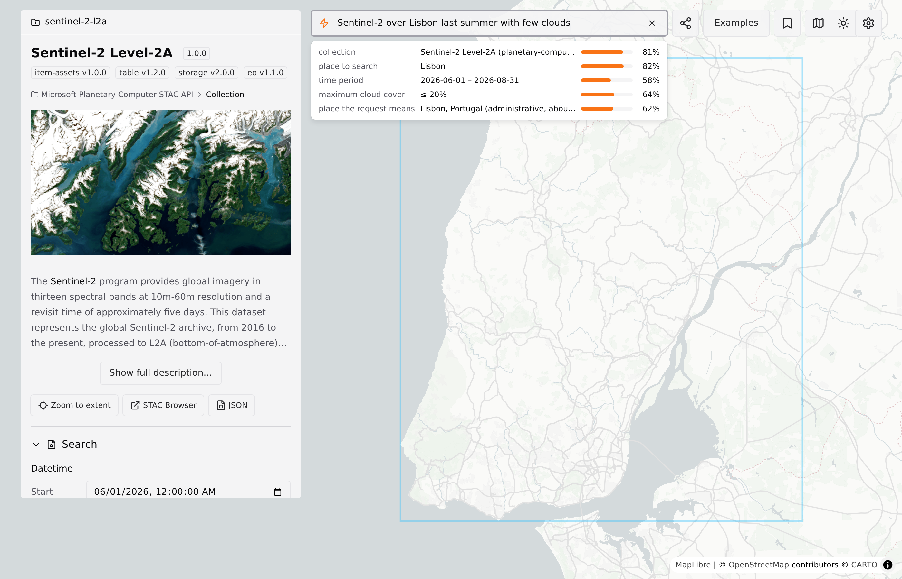

# Local open model

Date: 26 November 2026. The first report is [local-model-phase0.md](local-model-phase0.md). The plan is in
[developmentseed/stac-zap-models](https://huggingface.co/developmentseed/stac-zap-models/blob/main/PLAN.md).

stac-zap can now answer a request with open models that run in the browser, with no OpenRouter call. The model list
below the search bar selects "Jev + Clairic (OpenRouter)" or "Local open model (in the browser)". See the README,
"Local open model", to run it.

## Design

Three models, each IBM Granite Embedding 30M (Apache-2.0), fine-tuned, int8 weights, about 31 MB each:

| Model | Job |
|---|---|
| retriever | Shortlists 16 collections of all known catalogs for the request (bi-encoder). The vectors of the known collections are made before and load with the page (`vectors.json`, 0.6 MB for 1,021 curated collections). |
| decider | Picks one of the 16, or `keep` (cross-encoder, softmax with a calibrated temperature). **The catalog follows from the collection**: there is no catalog question. Also picks the place among the Photon results. |
| tagger | Marks the place, time and cloud cover words. Code makes the values: `src/zap/local/rules.ts` with chrono-node. |

Training data: requests from templates with exact labels (`training/generate.ts`), from the STAC snapshot and
GeoNames and Natural Earth places; no output of a closed model. Common data has groups: "Sentinel-2", "Landsat",
"elevation" and so on accept every main product, with Planetary Computer preferred; "aerial photos" or "lidar" of a
place accept the collections that cover the place. Training: one HF Jobs run on an L4 GPU, about 20 minutes.

## Results

Field test (30 requests, curated catalogs) and the extraction tests of `eval/cases.ts`, in Node with the int8 files
the page loads (`eval/local/pipeline.ts`). test-claude-v1: 240 requests that Claude wrote; it shares the habits of
the generator, so its scores are optimistic.

| | Jev 1.13 | Clairic | v2: catalog question, then collection | **v5: catalog follows collection** |
|---|---|---|---|---|
| Field test: catalog | 28/30 | | 25/30 | 18/30 |
| Field test: catalog and collection | 27/27 | | 22/28 (in the right catalog) | 17/28 |
| Field test: place, time, cloud | 80/85 | 84/85 | 83/85 | 82/85 |
| Requests the option lists cannot hold | 0/16 | 16/16 | 15/16 | 15/16 |
| test-claude-v1: catalog | | | 76/240 | **202/240** |
| test-claude-v1: catalog and collection | | | | 162/240 |

v2 asks for the catalog first and is better on the curated field test; v5 is much better over all 33 catalogs and
needs no catalog question, so a catalog in the vectors file works without retraining. Of the 11 field-test misses
of v5, several are the same data in another catalog (Earth Search instead of Planetary Computer) or topic requests
("drone imagery", "wildfires in Los Angeles").

In the browser (headless Chromium, ARM Chromebook, one thread), a zap takes 5 to 11 s, with the geocoder and the
STAC requests. A sequence of eight requests with follow-ups opened the expected collection each time: Sentinel-2
Lisbon, SWISSIMAGE 10 cm for Zurich, a Copernicus DEM for Mount Everest, Landsat Perth (≤ 12%), "now in 2021"
(keeps Landsat, sets 2021), Hurricane Idalia, "same for Hurricane Ian".

## Problems found and fixed

1. **Dynamic int8 broke the models** (ONNX Runtime `quantize_dynamic` also makes the activations int8). The decider
   agreed with fp32 on 47% of questions. Weight-only int8 (`training/tools/weight_only.py`): 95%, the same size.
   The model computes in fp32, so it is slower than the phase 0 bench.
2. **The generator gave generic names to every matching collection**: "Sentinel-2" pointed to dozens of mosaics, each
   the only correct answer. Groups fixed it (field-test collection 12/28 → 22/28).
3. **After the first zap the model kept the open collection** for every request, as it saw `keep` mostly in
   follow-ups. Training now adds an open collection to 40% of new requests, and the page asks twice: first as a new
   request; only when no collection gets 75% does it offer `keep`.
4. **Long current collection ids** made the query longer than the model input; pairs are now cut longest first, as
   in the page.

## Limits

- **Place pick**: it follows the order of Photon. "Perth" gives Perth, Scotland, and "the Matterhorn" a hill in
  Connecticut. Photon gives no population, so the model has no sense of how important a place is.
- **Regional data**: "aerial photos of Hannover" opens NAIP (USA), not the Lower Saxony orthophotos.
- **Tagger**: "only cloud-free" with no other words is not read; "Mount Everest" became "Mount" (the geocoder still
  found it).
- **English only**: the 30M model does not read the German and French titles of the Swiss catalog well.
- **Download**: about 95 MB on the first visit (three models of 31 MB and the vectors), from the site. The model
  repo on Hugging Face is private, so a deployed site needs the files with the site, or the repo made public.

## Next

- Topic and paraphrase requests from open models (phase 2), for "drone imagery", "wildfires", "radar images".
- Place pick: Photon's importance or the place type in the option text.
- One backbone with three heads: one download of about 31 MB instead of 95 MB.
- A test set written by people.
